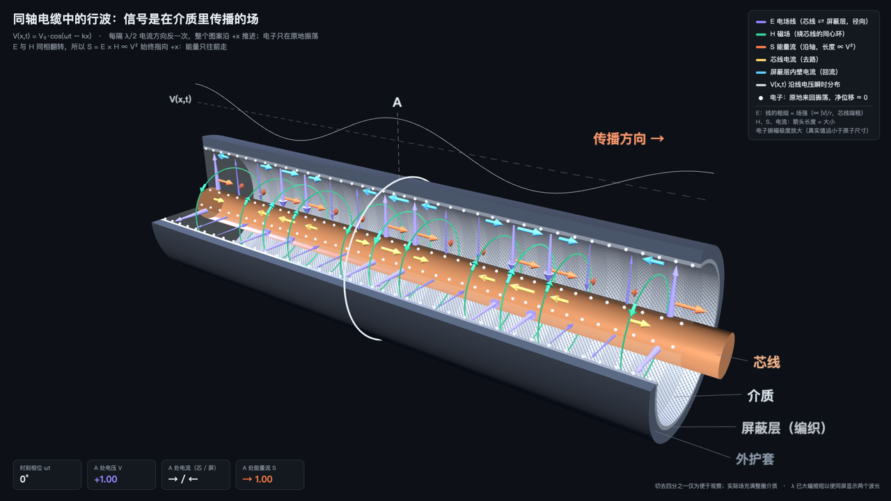

# 同轴电缆行波 3D 动画

**信号不是"电子从一头跑到另一头"，而是电磁场在介质里向前传播。**

一个可交互的 Three.js 3D 动画：切开一段同轴电缆，看行波 V(x,t) = V₀·cos(ωt − kx) 推进时，电场、磁场、能量流、电流和电子各自在做什么。

同系列：[屏蔽双绞线版](https://github.com/wangbrightly/stp-traveling-wave-3d)　·　[屏蔽平行线版](https://github.com/wangbrightly/shielded-pair-traveling-wave-3d)

### [▶ 在线打开（可拖动旋转）](https://wangbrightly.github.io/coax-traveling-wave-3d/)



视频版（1920×1080，8 秒无缝循环，可直接插入 PPT / WPS）：[coax-traveling-wave-3d.mp4](coax-traveling-wave-3d.mp4)

---

## 画面里有什么

| 颜色 | 物理量 | 怎么画的 |
|---|---|---|
| 紫 | 电场 E（芯线 ⇄ 屏蔽层，径向） | 电场线从芯线连到屏蔽层；**线的粗细 = 场强**，整体 ∝ \|V\|，沿半径按 1/r 收细（芯线端粗） |
| 绿 | 磁场 H（绕芯线的同心环） | 环上箭头长度 ∝ \|V\|，方向按右手定则 |
| 橙 | 能量流 S = E × H | 长度 ∝ V²，**始终指向 +x** |
| 黄 / 青 | 芯线电流 / 屏蔽层内壁回流 | 长度 ∝ \|V\|，两者等量反向 |
| 白点 | 电子 | 在平衡位置附近来回振荡，净位移 ≈ 0 |
| 白线 | V(x,t) | 沿线电压瞬时分布，可以直接看到波向右推进 |

## 动画想讲清楚的几件事

1. **每隔半个波长，电流方向反一次。** 同一时刻，电缆上不同位置的电流方向并不相同。
2. **E 和 H 同时翻转**，所以它们的叉积 S 永远指向前方：能量只往前走，在电压零点处为零，在波峰处最大。
3. **电子几乎不动。** 电子速度 ∝ −I，积分得到位移 ξ = −A·sin(ωt − kx)：它们只在原地来回摆动。真正向前跑的是场的图案。
   电子在某处被"挤走"，那里的芯线就带正电，这正是电压为正的区段。这一点在画面里电子的疏密上也能看出来。
4. **场强在芯线表面最大**（E ∝ 1/r）：介质击穿、功率容量都由这里决定。

## 示意上的取舍

- 切去四分之一电缆只是为了看清内部；场实际充满整圈介质，切口处画出的场是"假如没切开"时的样子。
- 波长被大幅缩短，以便同屏显示两个波长。
- **电子振幅被极度放大。** 以 1 V / 50 Ω / 1 GHz、芯线直径 0.5 mm 估算：漂移速度约 7×10⁻⁶ m/s，振幅约 10⁻¹⁵ m，远小于原子尺寸。电子的疏密变化同样是放大后的示意。
- 只画了理想 TEM 行波：无损耗、无反射、匹配端接。

## 使用

- **在线看**：打开上面的链接。可以拖动旋转、暂停，或拖动相位滑块。
- **离线看**：下载 `index.html` 双击打开。Three.js 已内嵌在文件里，不需要联网。
- **放进 PPT**：插入 → 视频 → 选 `coax-traveling-wave-3d.mp4`，播放方式设为"循环播放"。

## 重新生成

```bash
# 1. 改源码 src/coax3d.src.html 后打包成单文件
python3 src/build.py src/coax3d.src.html src/lib/three.min.js src/lib/OrbitControls.js index.html src/assets/reward-wechat.png

# 2. 逐帧录制（需要 Node.js 和 puppeteer），再用 ffmpeg 合成视频
npm install puppeteer
node src/record.js index.html frames/
ffmpeg -framerate 30 -i frames/f%04d.png -c:v libx264 -crf 18 -pix_fmt yuv420p -movflags +faststart coax-traveling-wave-3d.mp4
```

录制模式是 `index.html#record`：页面暴露 `window.__rec.frame(t)` 接口，按确定的时间逐帧渲染，所以视频不会掉帧，首尾也能无缝衔接。

## 赞赏

如果这个动画帮你讲清楚了一件事，欢迎请作者喝杯咖啡 ☕

打开[在线页面](https://wangbrightly.github.io/coax-traveling-wave-3d/)，点右下角「☕ 赞赏」即可看到微信赞赏码。

## 许可

代码以 [MIT](LICENSE) 许可发布。内嵌的 [Three.js](https://threejs.org) r147 同为 MIT 许可（见 `src/lib/LICENSE-three.txt`）。
